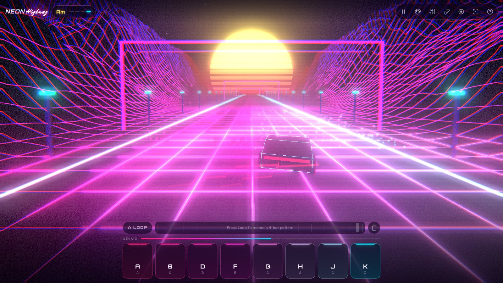
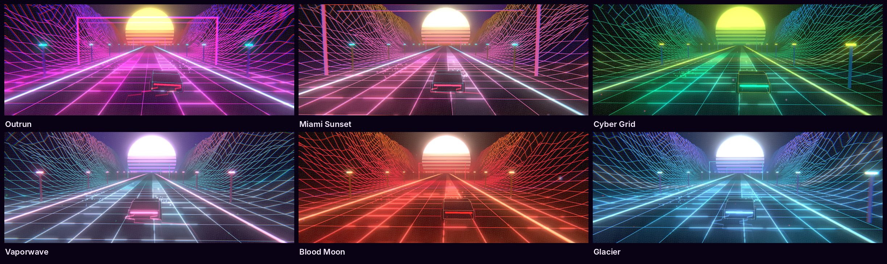
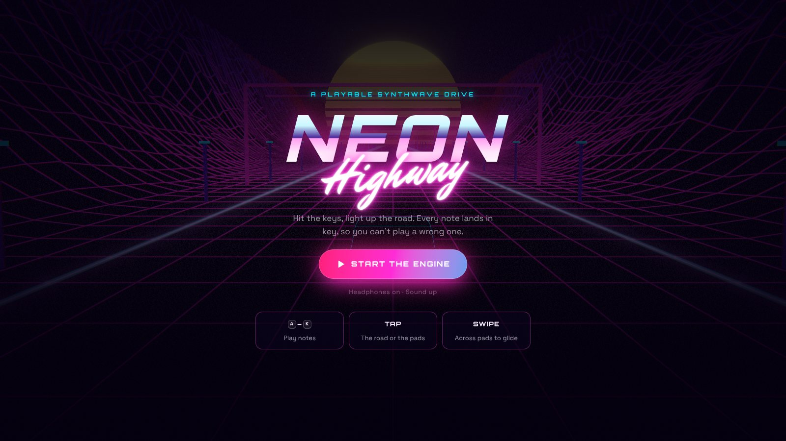
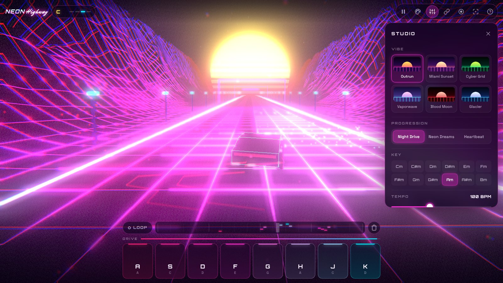
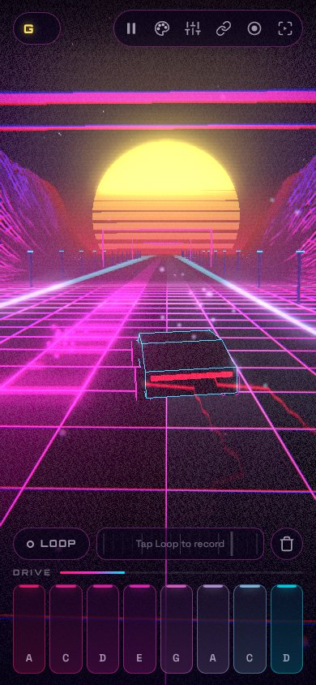

# Neon Highway

An endless synthwave drive you play like an instrument. Hit the keys, light up the road. Every note is locked to a minor-pentatonic scale over the backing track, so nothing you play sounds wrong.

**[▶ Play it live](https://neon-highway-ashy.vercel.app)**



## Features

- **Playable world:** every note steers the car into its lane, fires a light streak at the sun, throws sparks and ripples the grid. The kick drum pulses the whole road.
- **Always in key:** drums, octave bass, arp and pads run on Tone.js, and the 8 lead lanes map to a minor-pentatonic scale.
- **Loop recorder:** capture a 4-bar pattern and keep jamming over it.
- **Six themes:** Outrun, Miami Sunset, Cyber Grid, Vaporwave, Blood Moon and Glacier.
- **Share a jam:** your theme, key, tempo, progression, layers and loop are packed into the URL.
- **Record:** captures the canvas plus audio to MP4 (or WebM, depending on the browser).
- **VJ mode:** fullscreen, auto-composed melodies and cinematic camera cuts.

## Screenshots



| Title screen | Studio panel |
| --- | --- |
|  |  |

<p align="center">
  
  <br />
  <sub>Touch-first on mobile: tap the pads or the road, and slide across pads to glide.</sub>
</p>

## Controls

| Input | Action |
| --- | --- |
| `A S D F G H J K` / tap pads / tap the road | Play the 8 lanes (slide across pads to glide) |
| `Space` | Pause / resume |
| `L` · `Backspace` | Loop record on/off · clear loop |
| `1`–`4` | Toggle drums, bass, arp, pads |
| `T` · `P` | Next theme · next chord progression |
| `↑ ↓` · `← →` | Tempo · key |
| `M` · `R` · `V` · `?` | Studio · record video · VJ mode · shortcuts |

## Stack

- **Three.js:** a shader-driven scrolling grid with fbm-ridged mountains, a striped sun, pooled light streaks, sparks and ripples, and a post chain of bloom plus a CRT pass (chromatic aberration, scanlines, grain)
- **Tone.js:** a synthesized drum kit, octave bass, arp, chorus pads and a fat-saw lead, scheduled on the transport and synced to visuals through a lossless event queue
- **Vite:** no framework, about 200 KB gzipped in total

```bash
npm install
npm run dev     # http://localhost:5173
npm run build   # dist/
```
